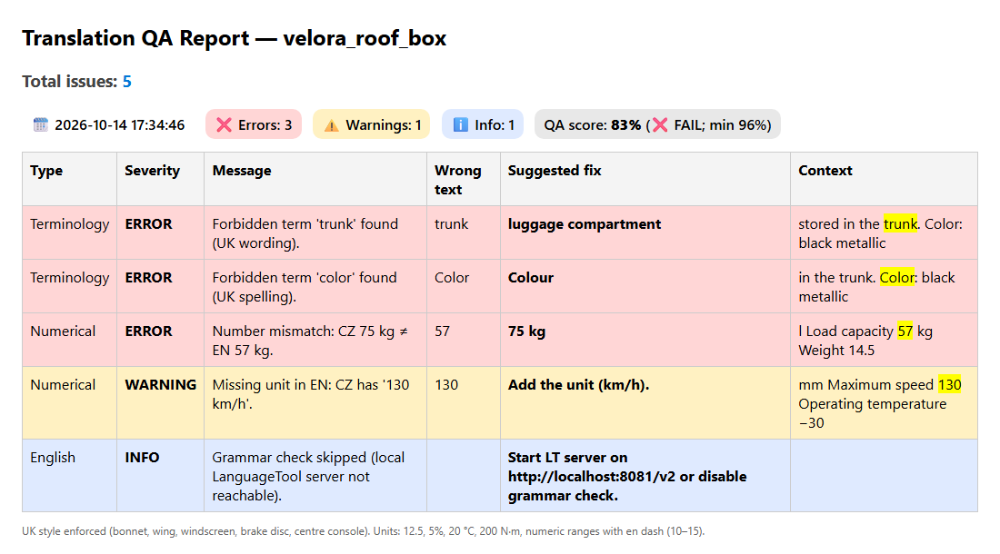

# Translation QA Checker

Automated QA for English translations of Czech product sheets. It takes a CZ/EN pair of PDFs, extracts the text, runs rule-based checks (terminology, numbers and units, formatting, optional grammar) and writes an HTML/CSV report with a QA score.

> This is an anonymized version of an internal tool I built for an automotive client. The brand, model names, terminology and house-style rules were replaced with a fictional brand (VELORA). No client documents are included.



## Pipeline

```
X_cz.pdf ─┐
          ├─► extract ─► checks ─► dedupe ─► score ─► report (HTML + CSV)
X_en.pdf ─┘
```

1. **Extract** – finds `<name>_cz.pdf` + `<name>_en.pdf` pairs (recursively), extracts text with PyMuPDF, normalizes ligatures (fi → fi).
2. **Checks** – each issue has a severity, a suggested fix and the surrounding context:
   - forbidden terms (US spelling, house style), with a phrase whitelist for official product names
   - Czech termbase terms left untranslated in the EN text
   - numbers: values present in only one language, a single typo (`CZ 75 kg ≠ EN 57 kg`), missing units
   - regex rules: decimal separator, unit formatting, en dash in ranges, Czech diacritics, brand and model capitalization
   - grammar via a local LanguageTool server (optional)
   - DeepL reference translation – flags EN text that differs a lot (optional, INFO only, not scored)
3. **Dedupe** – drops LanguageTool hits that repeat an issue already reported by a custom rule.
4. **Score** – `100 − 5 × errors − 2 × warnings`, PASS at ≥ 96. Both are set in the rules file.
5. **Report** – `Output/<name>_QA_<timestamp>/qa_report.html` and `qa_report.csv`, sorted by severity, with the error highlighted in its context.

## Quick start

Python 3.11+.

```bash
python -m venv .venv
.venv\Scripts\activate          # Linux/macOS: source .venv/bin/activate
pip install -r requirements.txt
python auto_qa.py --input examples
```

```
[INFO] Loading rules from rules.example.json …
[INFO] Found 1 pair(s). Processing …
  • velora_roof_box_en.pdf  (with velora_roof_box_cz.pdf)
[DONE] All pairs processed. Errors=3  Warnings=1  Info=1  AvgScore=83%
```

The report opens in the browser. The example EN sheet contains four planted errors:

| Planted error | Reported as |
|---|---|
| wrong number (CZ 75 kg, EN 57 kg) | ERROR `Number mismatch: CZ 75 kg ≠ EN 57 kg.` |
| missing unit (`130` instead of `130 km/h`) | WARNING `Missing unit in EN: CZ has '130 km/h'.` |
| American English (`Color`) | ERROR, suggested fix `Colour` |
| forbidden term (`trunk`) | ERROR, suggested fix `luggage compartment` |

The INFO row only says that the grammar check was skipped because no LanguageTool server was running.

Usage: `python auto_qa.py [--input DIR] [--rules FILE]` (defaults: `Input/`, `rules.example.json`).
`python examples/make_examples.py` regenerates the example PDFs.

**Tests:** `pytest` (offline, no Java or API key needed).

**Optional services** – copy `.env.example` to `.env`:
- `LT_URL` – LanguageTool server (default `http://localhost:8081/v2`). Needs Java. On Windows, `MASTER_RUN.bat` starts the server from `LT_DIR` and runs the checker.
- `DEEPL_API_KEY` – enables the DeepL reference translation.

## Rules config

All client-specific knowledge lives in a JSON file; the code contains none. For real rules, copy `rules.example.json` to `rules.json` (git-ignored) and run with `--rules rules.json`.

| Key | Purpose |
|---|---|
| `language` | target language for LanguageTool and DeepL (`en-GB`) |
| `scoring` | `error_penalty`, `warning_penalty`, `pass_threshold` (`null` hides PASS/FAIL) |
| `units` | units recognized after a number (missing-unit check) |
| `forbidden_terms` | `wrong` → `correct`, with a `reason` shown in the report |
| `forbidden_phrase_whitelist` | phrases where a forbidden term is allowed (product names) |
| `termbase` | CZ → EN pairs; CZ terms found in the EN text are reported; also used as the DeepL glossary |
| `grammar_whitelist` | words LanguageTool should not flag |
| `regex_rules` | `name`, `pattern`, `message`, `severity` + optional flags below |
| `deepl_glossary_name`, `report_note` | DeepL glossary name; footer note in the HTML report |

Optional regex rule flags:

| Flag | Effect | Example |
|---|---|---|
| `case_sensitive` | match case-sensitively (default: ignore case) | `20 °c` reported, `20 °C` not |
| `skip_if_uppercase` | ignore matches already in ALL CAPS | `Nivara` reported, `NIVARA` not |
| `allow_exact` | ignore matches equal to this exact form | `VELORA Genuine Accessories` |
| `suggest` | fixed suggested fix shown in the report | `VELORA` |

```json
{
  "name": "Brand name",
  "pattern": "\\bVelora\\b",
  "message": "Brand name must be written in capitals: VELORA.",
  "severity": "ERROR",
  "skip_if_uppercase": true,
  "suggest": "VELORA"
}
```

## Design decisions

- **Rules as data, not code.** The internal version had the brand, model names and exceptions keyed on exact message texts hard-coded in Python. Moving them to JSON with per-rule flags made the code client-agnostic, and term lists can change without touching code.
- **Language-aware number parsing.** Czech uses a space (also U+00A0 / U+202F) for thousands and a comma for decimals; English uses a comma + 3 digits and a dot. Numbers are normalized before comparison, so `1 500 kg` = `1,500 kg`. A wrong EN decimal comma (`12,5`) is read as 12.5 and reported once, by the formatting rule.
- **Offline tests that check the exact set of issues.** The test on the example PDFs asserts the exact set of reported issues, so it fails on a missed error as well as on a false positive. DeepL and LanguageTool are disabled or mocked.

## Known limitations

- Czech `10 200` is read as one number (10200) even when meant as two – plain text cannot tell them apart.
- Numbers are compared as sets: a value present in both languages but in the wrong place is not detected.
- The generated example PDFs are cleaner than real product sheets (multi-column layouts, headers/footers, hyphenation). Scanned PDFs are not supported (no OCR).
- The grammar check needs Java and a running LanguageTool server; without it the check is skipped.

## Project structure

```
auto_qa.py            # the whole pipeline (CLI)
rules.example.json    # fictional rules (VELORA brand)
examples/             # example CZ/EN PDFs + generator script
tests/                # pytest, offline
docs/report.png       # screenshot above
MASTER_RUN.bat        # Windows launcher: starts LanguageTool, runs the checker
```
